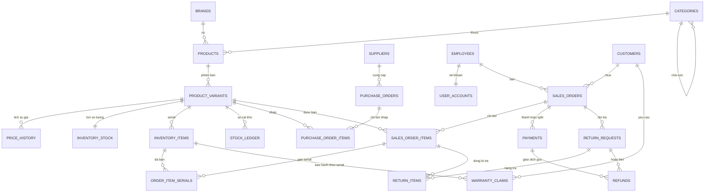

# ERD — SMARTSALES DATABASE

## Chú thích
- Quan hệ quan trọng nhất cho nghiệp vụ sau bán: `REFUNDS → PAYMENTS` (hoàn tiền luôn truy được về giao dịch gốc) và `WARRANTY_CLAIMS → INVENTORY_ITEMS` (bảo hành theo serial cụ thể, không theo model chung chung).
- `STOCK_LEDGER` là bảng chỉ-ghi-thêm (append-only) truy vết mọi biến động tồn.
- Khi cần bản nộp in: vẽ lại bằng dbdiagram.io/Draw.io theo quan hệ trên + Data Dictionary.
